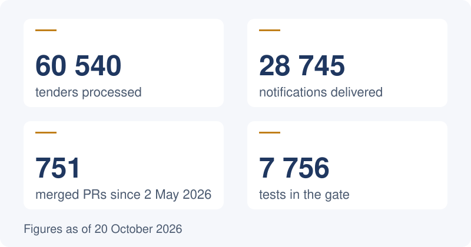
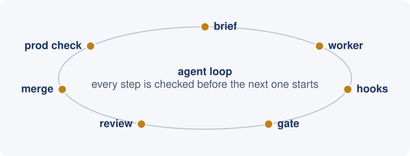

<picture>
  <source media="(prefers-color-scheme: dark)" srcset="assets/header-dark.svg">
  
</picture>

I have spent 25+ years in IT. I built a bank's IT from scratch: core banking, card processing, two data centers and a 10-minute RTO. I ran IT for a billing platform with 4M+ accounts, and delivered 93 projects with my own integration consultancy. Today I design AI systems: agents that write code under hard guardrails, with every change proven by tests and live data before it ships.

**Open to:** Presales Solutions Architect (AI/agentic systems) · AI Solutions Consultant · Presales Architect for AI and infrastructure. Full-time, part-time or contract. Remote, open to relocation.

## TenderSRB

A service that collects public tenders from Serbia and its neighbours, matches them to each client's profile, and gives an AI go / no-go verdict before the client spends time on a bid.

<picture>
  <source media="(prefers-color-scheme: dark)" srcset="assets/stats-dark.svg">
  
</picture>

**Live:** [app.nab.rs](https://app.nab.rs) · **News:** [t.me/nabrs_news](https://t.me/nabrs_news) · **Public code:** [TnSrb1/nabrs](https://github.com/TnSrb1/nabrs)

## How it is built

<picture>
  <source media="(prefers-color-scheme: dark)" srcset="assets/loop-dark.svg">
  
</picture>

A coordinator agent and worker agents (Claude Code) do the engineering. The coordinator checks that a task has value in real data, writes the brief, runs the gate and verifies the live site; a second agent reviews each pull request. A human owns the decisions, the money and production data.

Process and decisions: [TnSrb1/agent-ops](https://github.com/TnSrb1/agent-ops)

## Recent work

- **21 Oct 2026**: search by source tender number, per-tenant control of the stepwise AI analysis, and public pages that state what the AI reads and the plan limits.
- **20 Oct**: AI document analysis: extraction from .doc, .odt, .rtf and .zip files, then stepwise review.
- **19 Oct**: Bosnia and Herzegovina source added: 2,000+ tenders.
- **17 Oct**: public showcase of nabrs; notifications when a tender changes.

## Contact

[Website](https://victorromanovsite.github.io) · [LinkedIn](https://www.linkedin.com/in/romanovvictor/) · [Telegram](https://t.me/victorromanov_it) · victor.romanov.inbox@gmail.com
